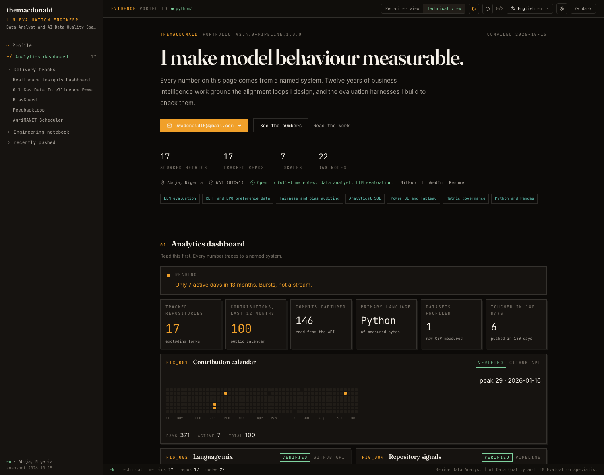
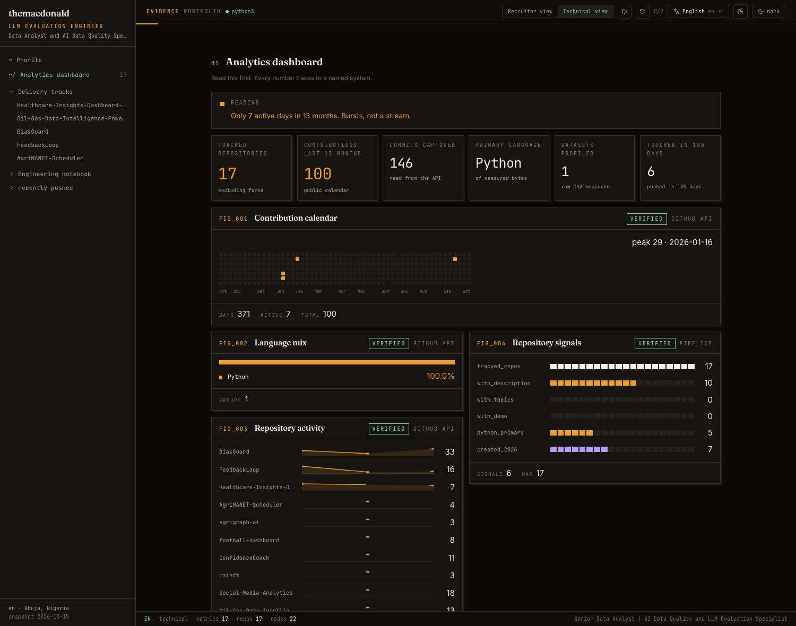
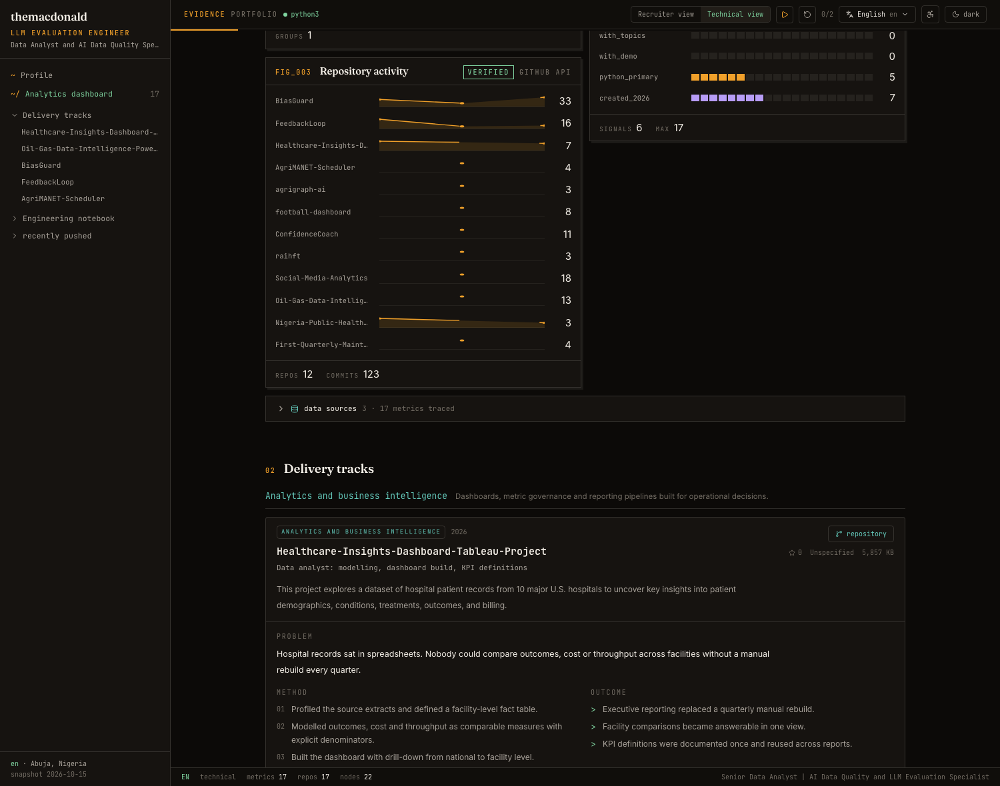
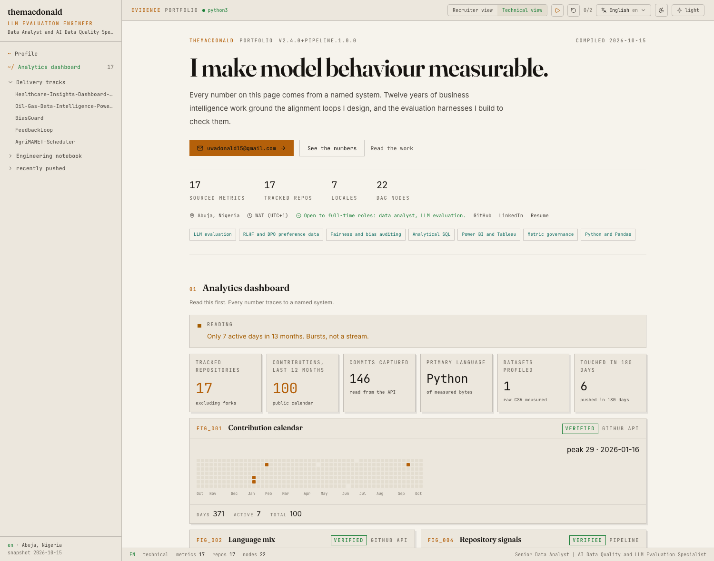

# Agentic Data-Driven Jupyter Portfolio Engine

A portfolio engine for data analysts and LLM evaluation engineers. It ingests
real telemetry from your own systems, compiles it into one architectural JSON
payload, and renders that payload as an interactive workspace styled after a
Jupyter Lab IDE.

The repository separates two concerns on purpose:

| Layer | Responsibility | Location |
| --- | --- | --- |
| Content telemetry | ingest, validate, localize, compile the payload | `pipeline/`, `data/config/`, `data/localization/`, `scripts/` |
| Presentation | read the compiled payload and render the workspace | `app/`, `components/`, `lib/`, `types/` |

No string in the presentation layer is hardcoded. Every label, metric, chart,
cell, and narrative comes from the compiled payload.

## The rule that shapes everything

**No metric ships without a named source.** Every number on the site is either

1. **read from GitHub** at sync time (repositories, languages, stars, commits,
   contribution calendar),
2. **computed by the pipeline** from that snapshot or from a raw dataset it
   downloads and measures, or
3. **declared by you** in `data/config/metrics.ts` or
   `data/config/case-studies.ts` with an explicit `sourceDetail` naming the
   system it was measured in.

Every metric renders with a provenance chip, every chart names its upstream
source, and a data-sources panel links each one. A portfolio that claims quality
work while shipping invented numbers contradicts itself, so the pipeline makes
that impossible rather than merely discouraged.

**Language attribution.** GitHub reports notebook bytes as "Jupyter Notebook",
which is an artifact format rather than a language. The pipeline groups those
bytes into the kernel language — a notebook executes Python — so the language
mix reports Python instead of letting an envelope format outrank the language it
carries. `pipeline/github_metrics.py::LANGUAGE_FAMILY` is the mapping.

**No scores.** Nothing in the dashboard grades the work. An earlier build showed
a repository "readiness" band chart, which mostly advertised unfinished
repositories. It now counts visible signals — descriptions, topics, live demos,
language, recency — so a reader learns the surface area without being handed a
verdict.

### Figures

Charts present as numbered plates — `FIG_001` onward — with a monospace label, a
hairline frame, and instrument readouts instead of prose captions.

| Figure | Form | Reads as |
| --- | --- | --- |
| `FIG_001` Contribution calendar | 53-week day cell grid | when the work happened, empty weeks included |
| `FIG_002` Language mix | proportional strip | one ribbon, percentages, no axis |
| `FIG_003` Repository activity | SVG commit curve per repository | which repositories carry depth |
| `FIG_004` Repository signals | tick meters | surface area, no score |

Bar charts were removed deliberately. A cell grid and a curve carry the same
numbers with more signal per pixel and less chart furniture.

### The design language: EVIDENCE

The subject is measurement, so the interface behaves like a technical dossier
rather than a dashboard.

**Type — three faces, three jobs.**

| Face | Role |
| --- | --- |
| **Fraunces** | Display. The headline, set with the `WONK` and optical-sizing axes active. Gives the page a voice without shouting. |
| **Inter** | Body. Quiet, legible, gets out of the way. |
| **JetBrains Mono** | Data. Every label, figure, node id and code line. |

**Colour — one hot accent, reserved for exact figures.**

- Canvas: warm near-black `#0c0a08` dark, bone paper `#f6f3ec` light. Not gray,
  not blue — warmth is what stops it reading as a template.
- **Amber `#f0a02a`** (`#b4600a` on paper) marks every measured number, every
  figure label, and the primary action. It is the only hot colour on the page.
- **Teal `#63c6b8`** carries method, source, and structure.
- Green, amber and red form a verdict spectrum used only for status.

**Rules.**

- Hairline separators at `rgba(ink, 0.14)`. No cards inside cards.
- Numbered plates with a `FIG_00X` label, and a hard offset shadow
  (`3px 3px 0`) so they read as printed matter.
- Focus is always visible: a 2px amber outline, never removed.

### Two mechanics that make it memorable

**1. The verdict.** The pipeline reads the telemetry and writes one sentence
about it, above the figures:

> Only 7 active days in 13 months. Bursts, not a stream.

`pipeline/github_metrics.py::derive_verdict` picks a code — `sparse`, `bursty`,
`steady`, `sustained` — and a tone from the same numbers the figures plot. The
sentence is localized; the numbers are not. It can say something unflattering,
which is the point: a measurement instrument that only flatters itself is
decoration.

**2. Evidence badges.** Every figure carries a `VERIFIED` or `SELF-REPORTED`
badge stating how its numbers were obtained — read from an API, computed from a
raw dataset, or declared by hand. Nothing on the page is allowed to look more
authoritative than it is.

### Engagement

- **Scroll reveal.** Sections and case studies stage in as they enter the
  viewport, with a stagger. Fully disabled by the reduce-motion toggle and by
  `prefers-reduced-motion`; content is never hidden from a reader.
- **Reading progress.** A 2px amber rule across the top of the reading pane.
- **Numbered sections** (`01` … `07`) so the page is scannable at a glance.
- **Hover grammar.** Links grow a 1px underline; plates lift 1px.

### Keyboard

| Keys | Action |
| --- | --- |
| `g` then `p` / `d` / `t` / `m` / `n` / `c` | jump to profile, dashboard, tracks, methodology, notebook, contact |
| `?` | toggle the shortcut sheet |
| `Esc` | close overlays |

Focus is respected: shortcuts never fire while a text field has focus.

## Quick start

```bash
npm install
npm run github:sync   # pull your own telemetry into data/github.snapshot.json
npm run pipeline      # validate + compile the payload
npm run dev           # http://localhost:3000
```

Production build (compile then build):

```bash
npm run build
```

## Preview

| View | Screenshot |
| --- | --- |
| Hero: promise, proof, actions |  |
| Verdict line, KPI readouts, `FIG_001`–`FIG_004` |  |
| Delivery tracks and case studies |  |
| Light archetype (bone paper) |  |

## Commands

| Command | Purpose |
| --- | --- |
| `npm run github:sync` | fetch profile, repos, languages, commits, contribution calendar, and profile any declared dataset CSV |
| `npm run pipeline` | validate every locale and claim, build the DAG, emit all artifacts |
| `npm run pipeline:test` | contract suite: schema walk, DAG integrity, numeric parity, label coverage |
| `npm run pipeline:validate` | contract checks only |
| `npm run typecheck` | `tsc --noEmit` |
| `npm run lint` | eslint |

## Making it yours

Five files, in this order.

### 1. `data/config/identity.ts` — who you are

Name, handle, job title, location, timezone, availability state, canonical URL,
and contacts. The `email` contact is the primary call to action and should be
the fastest way to reach you.

### 2. `public/resume.pdf` — your CV

The Contact section and the download prompt both point at `public/resume.pdf`.
Replace that file with your own CV and the link works; no code change needed.

Set `download` on the contact entry to control the saved filename:

```ts
{
  id: "resume",
  value: "CV.pdf",
  url: "/resume.pdf",
  download: "Your_Name_CV.pdf",
}
```

To regenerate the PDF from a Word source, convert it with the bundled
LibreOffice kit and copy the result over `public/resume.pdf`:

```sh
node <libreoffice-cli> convert --input docs/cv/Your_CV.docx --output public/resume.pdf
```

### 3. `data/config/github.ts` — what to ingest

`username`, `featured` repositories, `exclude` list, and which repos count as
`platform` tooling rather than analytical work.

### 4. `data/config/metrics.ts` — numbers only you can supply

Leave this empty and the site still publishes, because every shipped metric is
derived. Add entries when you have a real measurement:

```ts
{
  key: "reporting_cycle",
  labelKey: "reporting_cycle",
  value: 68,
  unit: "percent",
  context: "reduction, 2023-2025",
  source: "config",
  sourceDetail: "Power BI refresh audit, internal ProptVerse dashboard",
}
```

Then run `npm run pipeline`. The validator names every label key still missing a
translation, and `data/localization/dashboard-labels.<lang>.json` is where those
go.

### 5. `data/config/case-studies.ts` — the work itself

Each study declares a track, a repository, a stack, and `metrics`. Any metric
whose value is the string `manual-entry-required` renders as an em dash with a
warning that says so — the site never invents a number for you, and it is
honest about the gap until you fill it.

### 6. `data/localization/*.json` — the words

Seven locales ship: `en`, `fr`, `es`, `de`, `ru`, `ja`, `zh`. Each node holds
`interfaceLabels`, `shellLabels`, `profileNarrative`, `dashboardLabels`, four
`notebookCells`, and `projectDetails`.

## What is in the payload

```ts
interface AgenticPortfolioPayload {
  metadata: { engineerName; targetTitle; globalTelemetryVersion;
              systemLocation; availableLanguages; compiledTimestamp };
  dashboard: {
    generatedAt; capturedDaysAgo;
    metrics; tiles; charts; repositories; datasetProfiles; sources;
  };
  localizationRegistry: { [langKey]: LocalizationNode };
  systemArchitectureDAG: { nodes; edges };
}
```

The full TypeScript contract lives in
[`types/portfolio-contract.ts`](types/portfolio-contract.ts).

## The page

| Section | What a reader gets |
| --- | --- |
| Profile | name, positioning, availability, location, timezone, contact actions, four sourced headline metrics |
| Analytics dashboard | six KPI tiles (repositories, contributions, commits, primary language, datasets profiled, recency), a contribution heatmap, three supporting visualisations, and a collapsed data-sources panel |
| Delivery tracks | case studies grouped as analytics, LLM evaluation, and systems research |
| Methodology | how you score model output and decide a metric is trustworthy |
| Growth vector log | feature-level progress on the open-source engines |
| System architecture | the platform-agnostic dependency graph |
| Engineering notebook | the original Jupyter workspace with executable cells |
| Contact | every channel, email first |

### Two view modes

**Technical view** shows everything: source code, kernel controls, the notebook,
the DAG inspector, and the data-sources panel.

**Recruiter view** leads with outcomes. It hides the provenance panel, collapses
the long Python cells behind a "show source" affordance, and keeps every result
visible. The choice persists in `localStorage`.

### Notebook seeding

| Cell | Archetype | Content |
| --- | --- | --- |
| 01 | `markdown` | Header, executive summary, and the pivot from enterprise diagnostics to model alignment |
| 02 | `code` | Pandas telemetry initialization: cost optimization at Clean Express, yield scaling at Proptverse, quality protocols at Turing |
| 03 | `code` | Token safety evaluation matrix scored against strict baselines |
| 04 | `markdown` | Structural project node log cross-linked to `systemArchitectureDAG` |

Every code cell is executable Python. The pipeline compiles each cell with
`ast.parse` and runs it in a subprocess, asserting a zero exit code and non-empty
stdout.

## Dual-mode state archetypes

- **`dark`** — JupyterLab Dark. Slate canvas, vibrant minting, low-contrast text blocks.
- **`light`** — classic Jupyter Notebook. High-contrast canvas, structured delimiters, true indigo syntax keys.

Selected through `[data-theme]` on `<html>` and persisted under
`portfolio.theme`. A bootstrap script paints the stored archetype before
hydration so the workspace never flashes the wrong theme.

## Accessibility

- A reduce-motion toggle in the top bar, persisted, plus a
  `prefers-reduced-motion` media query.
- Semantic landmarks, `aria-pressed` on every toggle, labelled icon buttons.
- The sidebar becomes an off-canvas drawer under `lg`, so no fixed-width column
  eats a phone viewport.
- Charts expose `role="img"` with an accessible summary and per-bar titles.

## SEO

`lib/seo.tsx` derives Open Graph, Twitter card, and JSON-LD (`ProfilePage`,
`Person`, and one `SoftwareSourceCode` per featured repository) from the same
compiled payload the page renders, so structured data cannot drift from the site.

## Continuous integration

`.github/workflows/pipeline.yml` runs on push and pull request to `main`:

1. install Node 22 and Python 3.12 with `pandas` and `scipy`
2. bind `SOURCE_DATE_EPOCH` to the commit time
3. compile twice and diff, proving the payload is deterministic
4. run the pipeline test suite, typecheck, and lint
5. build the workspace and upload the compiled artifacts

## Deployment

### Vercel

`vercel.json` pins the build to `npm run pipeline && next build`. Connect the
repository and every push to `main` produces a production deployment. The build
reads the committed snapshot, so it never calls the network.

Set `SOURCE_DATE_EPOCH` as a project environment variable to pin the compile
timestamp to the commit.

### GitHub

```bash
git init
git add .
git commit -m "feat: agentic portfolio payload pipeline"
git branch -M main
git remote add origin git@github.com:themacdonald/portfolio.git
git push -u origin main
```

## Adding a locale

1. Copy `data/localization/en.json` to `data/localization/<key>.json`
2. copy `data/localization/dashboard-labels.en.json` to
   `data/localization/dashboard-labels.<key>.json`
3. translate both, then run `python3 scripts/inject_dashboard_labels.py`
4. add the key to `LANGUAGE_ORDER` in `pipeline/constants.py` and to
   `LANGUAGE_KEYS`, `LANGUAGE_LABELS`, `LANGUAGE_HTML_TAGS` in
   `types/portfolio-contract.ts`
5. run `npm run pipeline` — the validator fails on any missing label

## Repository layout

```
app/                         Next.js App Router shell
components/dashboard/        KPI tiles, charts, repo explorer, case studies
components/layout/           sidebar, workspace shell, section composition
components/notebook/         cells, telemetry grid, DAG panel, project nodes
components/workspace/        locale, theme, view mode, kernel state
data/config/                 the files you edit
docs/cv/                     editable CV source (.docx)
public/resume.pdf            the served CV
data/localization/           seven locale nodes plus label sets
data/github.snapshot.json    committed telemetry snapshot
data/portfolio.payload.json  compiled payload
lib/                         tokenizer, SEO graph, typed payload accessor
pipeline/                    fetcher, validator, compiler, metrics, DAG, tests
scripts/                     authoring and injection helpers
types/                       TypeScript contract interface
```
